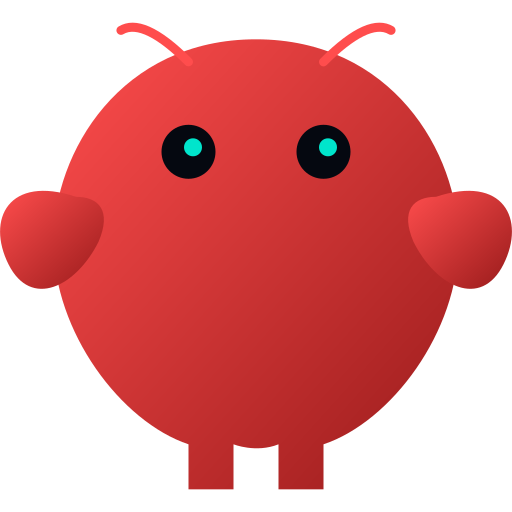

<p align="center">
  <picture>
    <source media="(prefers-color-scheme: dark)" srcset="assets/icon-dark.svg">
    
  </picture>
</p>

<h1 align="center">aac-openclaw</h1>

<p align="center">Self-hosted deployment definition for OpenClaw, an open-source AI assistant that runs on your own devices.</p>

<p align="center">
  <a href="https://github.com/openclaw/openclaw"></a>
  
  <a href="https://github.com/openclaw/openclaw/blob/main/LICENSE"></a>
</p>

## About

OpenClaw is an AI assistant that runs on your own hardware and talks to you in the chat
channels you already use. A single Gateway process runs the assistant, stores its state,
memory and credentials locally, and connects to the model providers and chat platforms
you configure. Models and agent harnesses are pluggable.

Key features (as described by upstream):

- Runs on your own hardware; state, memory and credentials stay local
- Chat channel integrations (for example Discord, Slack, Telegram and WhatsApp)
- Pluggable model providers and agent harnesses
- Native apps for macOS, iOS, Android, Windows and Linux
- Command-line interface for onboarding and administration

## Upstream

- Project: <https://github.com/openclaw/openclaw>
- Website: <https://openclaw.ai>
- Documentation: <https://docs.openclaw.ai>
- Container image: `ghcr.io/openclaw/openclaw:2026.6.1`
- License: MIT (upstream project)

## Quick start (Docker Compose)

The Compose file is rendered from `service.yml` by the App-as-Code template engine. For a
manual run, provide the values listed under "Configuration" in an environment file:

```bash
# Provide the values listed under "Configuration" in .env / stack.env
docker compose up -d
```

Secrets are not stored in this repository. Provide them through the deployment pipeline
or create the environment files yourself. Do not commit them.

## Configuration

Environment variables (defaults from `service.yml`; `CHANGE_ME` must be set per deployment):

| Variable | Default | Description |
|---|---|---|
| `TZ` | `Europe/Berlin` | Time zone |
| `HOME` | `/home/node` | Home directory inside the container |
| `OPENCLAW_CONFIG_PATH` | `CHANGE_ME` | Path to the OpenClaw configuration file inside the container |
| `OPENCLAW_PUBLIC_URL` | `CHANGE_ME` | Public URL of the gateway |
| `OPENCLAW_DISABLE_BONJOUR` | `1` | Disable Bonjour/mDNS service discovery |
| `OPENCLAW_ALLOW_INSECURE_PRIVATE_WS` | `false` | Allow unencrypted WebSocket connections to private addresses |
| `OPENCLAW_AGENT_MODEL` | `CHANGE_ME` | Default agent model |
| `TERM` | `xterm-256color` | Terminal type |
| `BROWSER` | `echo` | Browser command used by the CLI |
| `VIKUNJA_URL` | `CHANGE_ME` | Base URL of the Vikunja task manager integration |
| `VIKUNJA_TOKEN` | `CHANGE_ME` (secret) | API token for Vikunja |
| `OPENCLAW_GATEWAY_TOKEN` | `CHANGE_ME` (secret) | Token that protects the gateway |
| `GEMINI_API_KEY` | `CHANGE_ME` (secret) | API key for the Gemini model provider |
| `GITHUB_TOKEN` | `CHANGE_ME` (secret) | GitHub access token |
| `COPILOT_GITHUB_TOKEN` | `CHANGE_ME` (secret) | GitHub token for Copilot access |
| `DISCORD_BOT_TOKEN` | `CHANGE_ME` (secret) | Discord bot token |
| `GITLAB_TOKEN` | `CHANGE_ME` (secret) | GitLab access token |

Ports:

| Port | Protocol | Purpose |
|---|---|---|
| `18789` | TCP | Gateway (`gateway`), also published through Traefik |
| `18790` | TCP | Bridge (`bridge`) |

Volumes:

| Mount | Description |
|---|---|
| `config` -> `/home/node/.openclaw` | Persistent OpenClaw configuration |
| `workspace` -> `/home/node/.openclaw/workspace` | Persistent workspace |

The container runs `node dist/index.js gateway --bind lan --port 18789` and restarts
with the policy `always`. Its health check calls `http://127.0.0.1:18789/healthz`.

## Deploy with App-as-Code

1. Edit `service.yml`. It is the single source of truth for image, ports, environment,
   volumes, dependencies and per-stage overrides. Do not edit the rendered output.
2. Pushing to `main` (or a configured stage branch) runs the service pipeline, which renders
   the manifests with `aac-template-engine` and triggers the deployment.
3. Releases of this definition are published under <https://github.com/app-as-code/aac-openclaw>.

## Credits and license

OpenClaw is developed by the OpenClaw project and licensed under MIT. This repository only
contains the deployment definition for it and is not a fork of the application. The logo is
provided by the OpenClaw project; see [`assets/ICON_SOURCE.md`](assets/ICON_SOURCE.md) for
icon sources and licenses.
